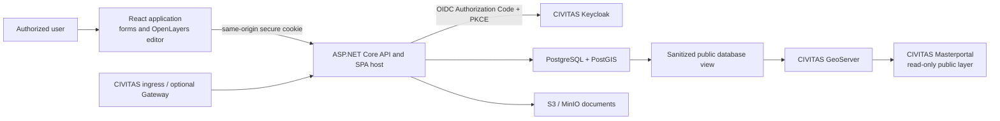

# Baikor_R Architecture and Implementation Plan

Last updated: 2026-10-19

## Implementation status

- Phase 0 is complete. The application source and GitHub Actions workflows are maintained in [Synnotech-AG/Baikor_R](https://github.com/Synnotech-AG/Baikor_R); the add-on source is maintained in its separate GitHub repository. CIVITAS consumes the add-on through a Git submodule. The manual Release workflow tests one source revision, publishes the image and Helm chart to GHCR, verifies anonymous downloads and creates a versioned GitHub release.
- Phase 1 is complete. React/OpenLayers, ASP.NET Core, tests, a production container, health endpoints, and the baseline Helm chart are implemented and verified.
- Phase 2 is in progress. The first PostGIS slice includes English persistence POCOs (`ConstructionSite` and `ConstructionSiteArea`), normalized 1:n tables, `geometry(Polygon,25832)` per area, GiST indexes, a clean English baseline migration, optimistic concurrency through `xmin`, use-case validation, controller-based create/get/list/update/delete/status endpoints, containerized migrations, and React create/list/map integration.
- Phase 3's authentication boundary is complete for the first slice: CIVITAS Keycloak OIDC, secure cookies, antiforgery protection, and API role policies are deployed. Broader authorization tests and organization/tenant rules remain.
- Phase 4 is in progress. Multiple individually named polygons, persistent map display, selection/focus/deletion, creation, update, workflow controls, contacts, communication entries, diversion information, and database-backed attachments exist; further Ort/Umfang metadata remains.
- Phase 6's first publication slice is complete. Approved/Active records flow through a sanitized PostGIS view, a dedicated GeoServer feature type, and an automatically registered Masterportal WMS layer.
- Phase 7 is in progress. The addon provisions an isolated database, database secrets, Keycloak roles and machine client, TLS, Helm, persistent session keys, GeoServer, a non-invasive Masterportal export, and an optional import machine client. It does not modify shared Service Portal registration or customer-owned Node-RED flows.
- Phases 5 and 8 have not started.

The immediate next slice is the remaining Ort/Umfang metadata plus update auditing. The first R-KOM trench ZIP import is implemented; additional importer formats can follow behind the same importer boundary.

## 1. Goal

Baikor_R will allow authorized municipal users to create and maintain construction-site records (Baustellen). A construction site owns one or more named polygon areas and combines them with operational metadata, contacts, workflow state, documents, communication references, diversion information, and a complete change history.

Only an explicitly approved, sanitized projection of the data will be visible to the public in the existing CIVITAS Masterportal. Editing will take place in a separate, Keycloak-protected application.

## 2. Decisions already made

- The protected application uses React and TypeScript.
- The protected map editor uses OpenLayers and the CIVITAS coordinate reference system EPSG:25832.
- The backend uses ASP.NET Core Web API.
- The backend is split into `BaikorR.Host` and `BaikorR.Core`: Host owns only HTTP hosting, authentication, observability, and dependency composition; Core owns typed configuration contracts, use cases, persistence, and shared domain-independent utilities without an ASP.NET dependency.
- HTTP endpoints use one-endpoint, attribute-routed MVC controllers organized by URL segments below `Controllers/Auth` and `Controllers/Api`. Controllers authorize, bind requests, invoke exactly one use-case service, and map its typed FluentResults outcome to an ASP.NET response. Request rules use nested FluentValidation validator types, response DTOs expose `Create` factory methods, and each source file has one top-level backend type.
- Each use-case folder owns a FluentResults factory for its success and failure outcomes. Failures carry a stable error key plus a short server-side explanation; the shared HTTP result mapper exposes RFC 7807 `detail`, `errorKey`, and field-level `errorKeys`, while the React client owns localized messages.
- Business logic is organized by use case below `Features/ConstructionSites` (`Create`, `Get`, `List`, `Update`, `Delete`, and `ChangeStatus`). EF entities are persistence-only POCOs below `Persistence/Entities`.
- Use-case services access construction-site persistence only through `Persistence/Sessions/IConstructionSitesSession`. `ConstructionSiteDbSession` is the single EF Core adapter, allowing service unit tests to use an in-memory session without an EF provider.
- Spatial persistence uses PostgreSQL/PostGIS through EF Core, Npgsql, and NetTopologySuite behind that session boundary.
- Serilog emits structured JSON logs to stdout and condenses HTTP requests into one event suitable for Kubernetes log collection.
- OpenTelemetry exposes ASP.NET Core and runtime metrics on a separate internal port. The Helm chart can create a Prometheus `ServiceMonitor` when CIVITAS operations monitoring is enabled; Grafana can then visualize those metrics, while Loki can ingest the Serilog stdout stream.
- Keycloak authenticates users through the ASP.NET OIDC handler. The API remains the authoritative authorization boundary and uses an HTTP-only session cookie plus antiforgery tokens.
- The local cluster exposes the add-on through CIVITAS ingress; Gateway API can be enabled by inventory.
- For the demonstrator, uploaded files and their metadata are stored in a dedicated PostgreSQL child table. Moving the BLOB content to CIVITAS-compatible S3/MinIO remains the intended scaling path.
- GeoServer publishes a sanitized read-only database view for Masterportal.
- Masterportal remains the public map. It will not be turned into the administrative editor.
- The application and the CIVITAS deployment add-on remain separate deliverables.

## 3. System architecture



Security must not depend solely on hiding editing controls in React. Every read, write, approval, upload, and administrative operation is authorized again by the API.

## 4. Repository and artifact responsibilities

### Application repository: `baikor_r`

This repository contains the product source and produces deployable artifacts.

```text
baikor_r/
├── src/
│   ├── BaikorR.Host/            # ASP.NET Core transport, security, telemetry, and SPA host
│   │   ├── Controllers/         # URL-segment/use-case-oriented HTTP transport
│   │   └── Hosting/             # grouped dependency registration and HTTP pipeline
│   ├── BaikorR.Core/            # application and persistence; no ASP.NET dependency
│   │   ├── Configuration/       # typed application configuration contracts
│   │   ├── Features/            # use-case services and contracts
│   │   ├── Persistence/         # EF Core context, Entities, and Sessions
│   │   └── Shared/              # cross-feature validation and spatial utilities
│   └── baikor-r-web/            # React, TypeScript, OpenLayers; shared UI utilities in src/shared
├── tests/
│   ├── BaikorR.Api.Tests/
│   ├── BaikorR.IntegrationTests/
│   └── e2e/
├── deploy/
│   └── helm/baikor-r/           # Kubernetes resources
├── docs/
├── Dockerfile
└── BaikorR.sln
```

The first deployment should use one container: React is built to static assets and served by ASP.NET Core alongside `/api`. This avoids CORS and keeps the initial CIVITAS deployment small. Frontend and API can be split later if operational requirements justify it.

Artifacts:

- A versioned OCI/Docker image.
- A versioned Helm chart, either published to an OCI/chart registry or packaged where the add-on can install it.
- Database migrations included with the backend and executed by a controlled migration job.

### Deployment repository: `baikor_r_addon`

The generated add-on repository contains CIVITAS-specific integration:

- Add-on inventory defaults and overrides.
- Namespace and Helm installation tasks.
- Image and chart version references.
- Ingress, Gateway, or APISIX routing.
- Keycloak client, roles, and redirect URI configuration.
- Database and object-storage credentials.
- GeoServer publication and Masterportal layer configuration where automation is appropriate.

It consumes versioned application artifacts; it does not compile the application source.

For a CIVITAS installation it is checked out as a Git submodule at:

```text
civitas-core/core_platform/addons/baikor_r_addon
```

The add-on is maintained in the public GitHub repository
`Synnotech-AG/Baikor_R.Addon`. CIVITAS checks it out as a proper submodule at the
path above. Local development may still override the chart and image in
inventory, but it must execute the add-on from that real submodule before a
change is considered deployment-compatible.

## 5. Domain scope

### Core construction-site record

- Stable identifier and human-readable reference number.
- Name and short description.
- One-to-many child records named `ConstructionSiteArea`; each stores a stable ID, a persisted display name such as `Area 1`, and one Polygon with SRID 25832.
- Area names are allocated in the frontend, persisted through the API, unique per construction site, and naturally sorted by their numeric suffix.
- Address/location description.
- Length, width, and height where applicable, including units.
- Affected areas: footway, cycleway, road, and other.
- Closure: full, partial, or other.
- Construction type: civil engineering (Tiefbau), building construction (Hochbau), or other.
- Accessibility impact and explanatory text.
- Planned and actual start/end dates.
- Workflow status: initially Vorentwurf, geplant, genehmigt, and laufend. Completion/cancellation states must be confirmed with the stakeholders before freezing the workflow.
- Optimistic concurrency version and created/modified metadata.

### Parties and contacts

- Applicant.
- Approver/authorizing organization.
- Implementing organization.
- On-site contact.
- Contact fields are private by default and require an explicit whitelist before public publication.

### Documents

- The implemented first slice stores file name, media type, size, and BLOB content in `construction_site_attachments`.
- Examples: application, permit, administrative decision, diversion plan, and communication material.
- A later iteration can move file content to S3/MinIO while retaining database metadata and stable attachment IDs.
- Download authorization is enforced by the API or short-lived signed URLs.

### Communication and diversions

- Communication channels and references: resident information, press release, signage, and social media.
- The first demonstrator records what was produced or published; it does not generate communication content.
- Diversion description plus optional documents or external links.

### Audit history

- Immutable audit entries for creates, updates, status transitions, document changes, and publication-relevant changes.
- Actor, timestamp, operation, entity version, and a structured change description.
- Audit history is not replaced by ordinary application logs.

## 6. Data-entry paths

The protected React application supports multiple paths without weakening authorization:

1. Map-first creation: draw one or more polygons, then complete the metadata form.
2. Form-first creation: enter metadata and save a draft before geometry exists. Approval and publication are blocked until valid geometry is supplied.
3. Geometry import: upload supported GeoJSON in the first import iteration; additional formats can follow if required.
4. API/bulk import: a documented authenticated API and a later CSV/GeoJSON import workflow for upstream systems.

The map editor must provide draw, add-area, modify, delete-area, snap, undo/cancel, zoom-to-feature, and validation feedback. Each drawn polygon is an independent `ConstructionSiteArea`; the frontend assigns its next stable `Area N` name before persistence.

## 7. Authorization and workflow

Initial application roles:

| Role | Capability |
| --- | --- |
| `baikor-viewer` | View non-public records allowed for the user's organization/tenant |
| `baikor-editor` | Create drafts and edit permitted records |
| `baikor-approver` | Approve records and perform controlled status transitions |
| `baikor-admin` | Manage configuration and exceptional corrections |

Keycloak role claims may be emitted as realm or client roles. The API will map the chosen CIVITAS client-role structure into ASP.NET authorization policies in one explicit claim-transformation component.

Status-transition rules must be implemented in a dedicated application service, not in persistence entities or the React client. Approval checks at least geometry validity, required metadata, dates, and publication rules. Direct status editing remains available for the current demonstrator requirement and is validated by the update use case.

## 8. Public publication

The authoritative tables are never exposed directly through GeoServer. A dedicated SQL view or materialized publication projection exposes only whitelisted fields and records eligible for publication.

The public pipeline is:

```text
approved/active record -> sanitized PostGIS view -> GeoServer layer -> Masterportal
```

The public layer must exclude private contacts, internal notes, object-storage keys, audit details, and unpublished documents. WMS is sufficient for visualization; WFS/OGC API exposure should be enabled only if a public feature API is explicitly required.

## 9. Implementation phases

### Phase 0 — Repository and scaffold normalization

- Establish the application repository structure.
- Decide the final remote locations for the application and add-on repositories.
- Keep `baikor_r_addon` as a separate Git repository and add it properly to CIVITAS as a submodule.
- Replace underscore-based Kubernetes/DNS names with `baikor-r` while retaining suitable C# naming such as `BaikorR`.
- Correct generated add-on placeholders: variable paths, gateway namespaces, service port, ingress behavior, and empty chart/image references.
- Record local build and deployment commands.

Exit criterion: both repositories have unambiguous responsibilities and the add-on can run a placeholder Helm release in the local CIVITAS cluster.

### Phase 1 — Application foundation

- Scaffold the ASP.NET Core API, React/TypeScript frontend, test projects, and Docker build.
- Serve the production React build from ASP.NET Core.
- Add health, readiness, and version endpoints.
- Add structured logging and configuration from environment variables/secrets.
- Create a minimal Helm chart with Deployment, Service, health probes, ConfigMap/Secret references, and migration Job.

Exit criterion: a versioned placeholder application runs directly and through the local Kubernetes cluster.

### Phase 2 — Spatial persistence and API

- Add PostGIS persistence with EF Core, Npgsql, and NetTopologySuite.
- Map `ConstructionSite` to `baikor.construction_sites` and its 1:n areas to `baikor.construction_site_areas`.
- Map every area geometry explicitly as `geometry(Polygon,25832)` and add a GiST spatial index.
- Implement persistence POCOs, migrations, use-case validation, optimistic concurrency, and audit history.
- Implement use-case services returning typed results and thin MVC controllers for CRUD/search endpoints with paging and bounding-box/spatial filtering.
- Add a sanitized publication view.
- Verify the preferred CIVITAS v1.7.1 mechanism for provisioning an isolated add-on database/user; keep application schema ownership separate from platform components.

Exit criterion: Baustellen survive pod restarts and can be queried spatially with no direct exposure of private tables.

### Phase 3 — Keycloak and authorization

- Register the React client and API audience/client in the CIVITAS realm.
- Use Authorization Code + PKCE for the browser.
- Validate issuer, audience, signature, lifetime, and required claims in ASP.NET Core.
- Create API authorization policies for viewer, editor, approver, and administrator roles.
- Configure APISIX routing and defense-in-depth authentication.
- Add authorization integration tests, including forbidden cross-role operations.

Exit criterion: anonymous and insufficiently privileged users cannot access protected data or mutations, even by calling the API directly.

### Phase 4 — Baustelle editor MVP

- Build list, search, details, create, and edit screens.
- Integrate OpenLayers with a CIVITAS/GeoServer base map and EPSG:25832 projection handling.
- Implement drawing and editing of multiple individually persisted Polygon areas.
- Build the metadata sections: Ort/Umfang, Wann, Wer, Status, Kommunikation, and Umleitung.
- Support drafts without geometry but prevent approval/publication until geometry and required fields are valid.
- Add status-transition UI according to API permissions.

Exit criterion: an authorized editor can create and update a persistent Baustelle, and an approver can approve a valid record.

### Phase 5 — Documents, imports, and change visibility

- Integrate S3/MinIO uploads and authorized downloads.
- Add document metadata, categories, limits, and allowed media-type validation.
- Display the audit/change history.
- Add GeoJSON geometry import.
- Define and document the authenticated integration API; add idempotency/external identifiers where upstream synchronization requires them.
- Add CSV/bulk import only after a concrete exchange format is agreed.

Exit criterion: documents and imported geometries remain persistent and access-controlled, and all important changes are attributable.

### Phase 6 — GeoServer and Masterportal publication

- Publish the sanitized view as a GeoServer layer.
- Style Baustellen by public status/time state.
- Add the read-only layer and information popup to the local Masterportal configuration.
- Confirm that private fields and non-public statuses cannot be retrieved through GeoServer.
- Decide cache invalidation/refresh behavior and verify an acceptable update delay.

Exit criterion: approving a Baustelle makes only its allowed fields visible in Masterportal; drafts and private data remain inaccessible.

### Phase 7 — CIVITAS add-on completion

- Finalize image and Helm chart references in `baikor_r_addon`.
- Pass database, object-storage, Keycloak, GeoServer, and application settings through inventory and Kubernetes secrets.
- Make installation idempotent and compatible with the local CIVITAS inventory.
- Add uninstall/upgrade considerations without deleting persistent data by default.
- Document how to build, deploy, upgrade, roll back, and diagnose the add-on.

Exit criterion: a fresh local CIVITAS installation can install the add-on from its documented inventory configuration and retain data across an application upgrade.

### Phase 8 — Quality, security, and demonstrator acceptance

- Unit tests for use-case rules and workflow transitions.
- Integration tests against real PostGIS and S3-compatible test services, preferably with Testcontainers.
- API authorization and publication-boundary tests.
- Playwright end-to-end tests for login, drawing, editing, approval, upload, and public visibility.
- Validate geometry size/complexity, upload limits, file names/media types, and error handling.
- Back up and restore the database and object store in a test run.
- Run a stakeholder acceptance session against the local CIVITAS instance.

Exit criterion: all demonstrator scenarios pass and persistence, authorization, privacy, and publication have been verified end to end.

## 10. Suggested first vertical slice

Do not build every form section before testing the integration. The first vertical slice should prove the risky boundaries:

1. Sign in through CIVITAS Keycloak as an editor.
2. Draw one or more named Polygon areas in React/OpenLayers.
3. Save its name, dates, status, and geometry through ASP.NET Core.
4. Persist it in PostGIS and reload it after a pod restart.
5. Approve it as an approver.
6. See the sanitized feature in GeoServer/Masterportal.
7. Confirm that a draft and its private fields are not publicly accessible.

Once this slice works, expand the metadata, documents, imports, and workflow without changing the core architecture.

## 11. Cross-cutting acceptance criteria

- Persistence: application data and documents survive pod restarts and application upgrades.
- Geometry: invalid or empty geometry cannot be approved; every persisted and published area is a valid Polygon in EPSG:25832.
- Authorization: all protected operations are rejected by the API for unauthorized roles.
- Privacy: only explicitly whitelisted fields reach GeoServer and Masterportal.
- Auditability: material changes and workflow transitions record actor and timestamp.
- Operability: health checks, structured logs, migrations, configuration, and secrets work in Kubernetes.
- Reproducibility: a new developer can build and deploy the add-on using documented commands.
- Independence: normal CIVITAS users can view public Baustellen without receiving editing privileges.

## 12. Open decisions requiring stakeholder input

These decisions do not block the first vertical slice, but must be settled before the affected phase is finalized:

- Exact required fields from the referenced municipal application form.
- Final status workflow, including completion, cancellation, rejection, and reopening.
- Whether approval requires one role or a multi-step/four-eyes process.
- Tenant/organization isolation rules.
- Which contact and document fields, if any, may be public.
- Document retention, maximum size, malware scanning, and allowed formats.
- Required upstream import formats and near-real-time synchronization expectations.
- Whether public WFS/OGC feature access is required in addition to WMS.
- Required map styles, expiry behavior, and historical display.
- Backup, retention, and deletion policies under applicable data-protection rules.

## 13. Reference documentation

- [CIVITAS/CORE add-on development](https://docs.core.civitasconnect.digital/docs/next/Development/Addons/)
- [CIVITAS/CORE platform installation](https://docs.core.civitasconnect.digital/docs/Deployment/Platform-Installation)
- [Npgsql spatial mapping with NetTopologySuite](https://www.npgsql.org/efcore/mapping/nts.html)
- [ASP.NET Core JWT bearer authentication](https://learn.microsoft.com/en-us/aspnet/core/security/authentication/configure-jwt-bearer-authentication)
- [OpenLayers MultiPolygon API](https://openlayers.org/en/latest/apidoc/module-ol_geom_MultiPolygon-MultiPolygon.html)
